# Окружение разработки

Планируемая платформа проекта — Mac M1 с архитектурой ARM64. Таблица описывает выбранный стек будущего приложения.

| Компонент | Средство |
|---|---|
| Язык | Python 3.13 |
| Веб-приложение | Flask |
| База данных | PostgreSQL 17 |
| Контейнеры | Docker Desktop для Apple Silicon и Docker Compose |
| Автоматизация | GitHub Actions и собственный runner ARM64 |

## Работа с документацией

Для этой практической используются Markdown, Git, GitHub Wiki и GitHub Pages. Установка и запуск компонентов приложения относятся к следующим работам.

```bash
git --version
git status
git log --oneline -5
```

```mermaid
flowchart TD
    %% Слои приложения
    subgraph ClientLayer ["Клиентский уровень"]
        Browser["Браузер пользователя"]
    end

    subgraph AppLayer ["Уровень логики (Веб-сервер)"]
        FlaskServer["Flask Application (Python 3.13)"]
        Routing["Роутинг & Контроллеры"]
        Templates["Шаблоны / API эндпоинты"]
        
        FlaskServer --- Routing
        Routing --- Templates
    end

    subgraph DataLayer ["Уровень данных"]
        DB[("БД (PostgreSQL)")]
    end

    %% Связи потоков
    Browser -->|HTTP REST запросы / Код 200| FlaskServer
    FlaskServer -->|SQL / ORM| DB
    DB -->|Выборка данных| FlaskServer
    Templates -->|HTML / JSON| Browser

    %% Оформление
    style FlaskServer fill:#000,stroke:#fff,stroke-width:2px,color:#fff
    style DB fill:#336791,stroke:#fff,stroke-width:1px,color:#fff
```


